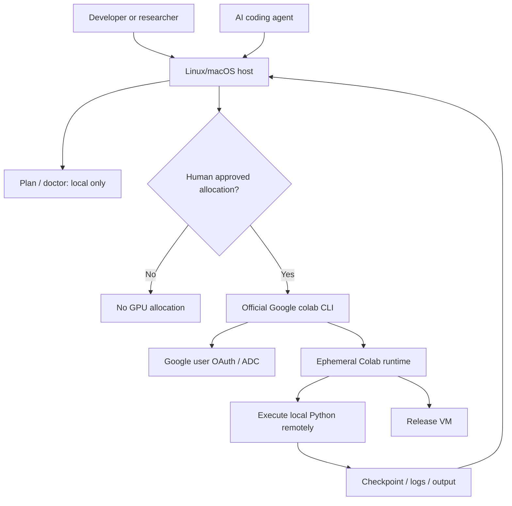

# Architecture and lifecycle



This project adds host-side guidance, an interactive one-shot approval gate, agent policy and offline tests; **Google's official CLI** owns provisioning, authentication, code execution and file transfer.

## Runtime lifecycle

**One-shot:** `colab run --gpu T4 script.py` allocates a fresh runtime, executes, and normally tears down. `colab_server.py run` asks the human to approve and delegates to that upstream command.

**Stateful:** `colab new -s trainer --gpu T4` → `install` / `upload` / `exec` → `download` → `stop`. Capture artifacts before stop. Treat remote loss and disconnects as expected failure modes. Never assume an `exec` process exit code alone proves success.

A Colab GPU is an independent remote accelerator, **not** a CUDA device on the host and **not** pooled VRAM with local GPUs. Colab subscription tiers, availability, quotas and resource lifetime govern what can be allocated.

## Optional external orchestrator

A consuming system may expose a structured GPU provider with states:

```text
DRAFT -> VALIDATED -> WAITING_APPROVAL -> APPROVED -> ALLOCATING
      -> RUNNING -> COLLECTING -> CLEANUP -> SUCCEEDED | FAILED | CANCELLED
```

Track job ID, code revision, requested GPU, artifacts, session ID, runtime and result. Never store tokens or access URLs in public logs. Human approval should live in a separately protected control plane; a prompt in the same OS account is not a security boundary against a malicious agent.

## Explicit design exclusions

No always-on GPU daemon, no keep-alive bypass, no subscription sharing, no vendor-specific server configuration, no live Colab calls in CI and no private infrastructure assumptions.
